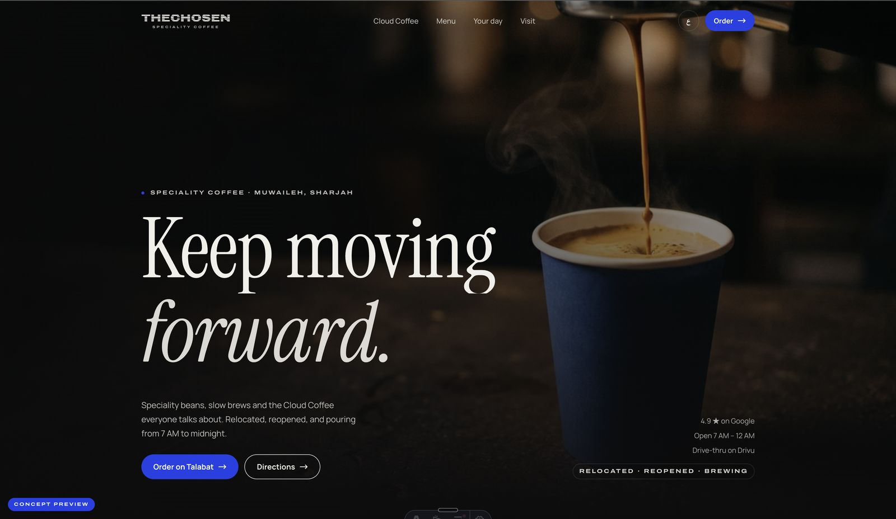
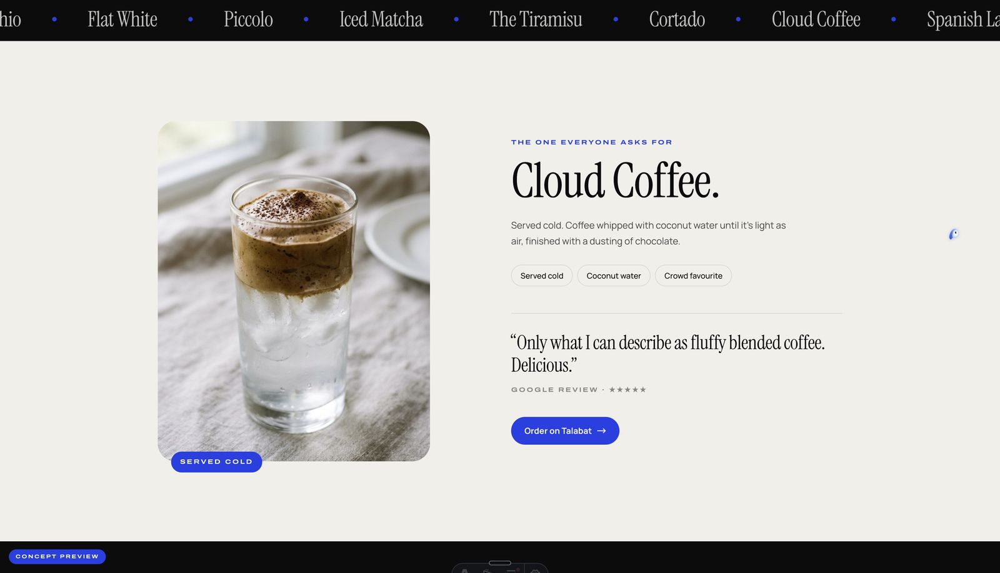
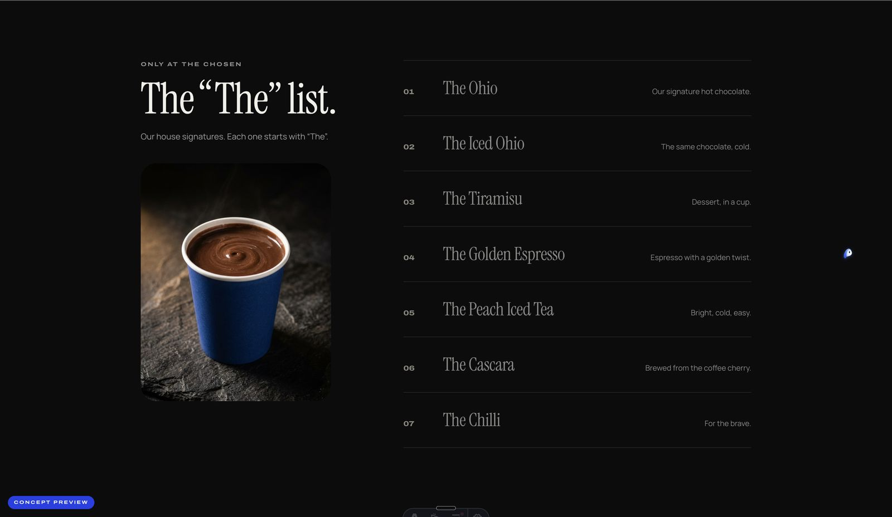
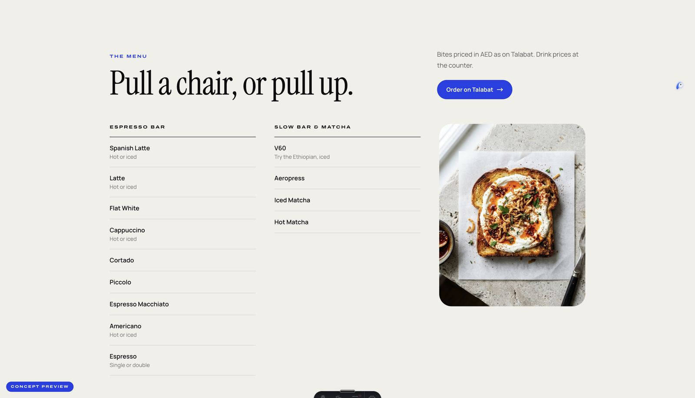
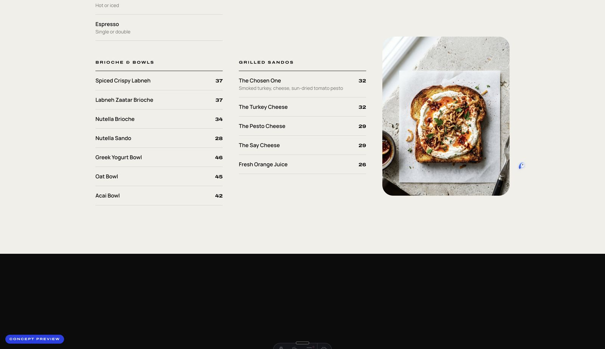
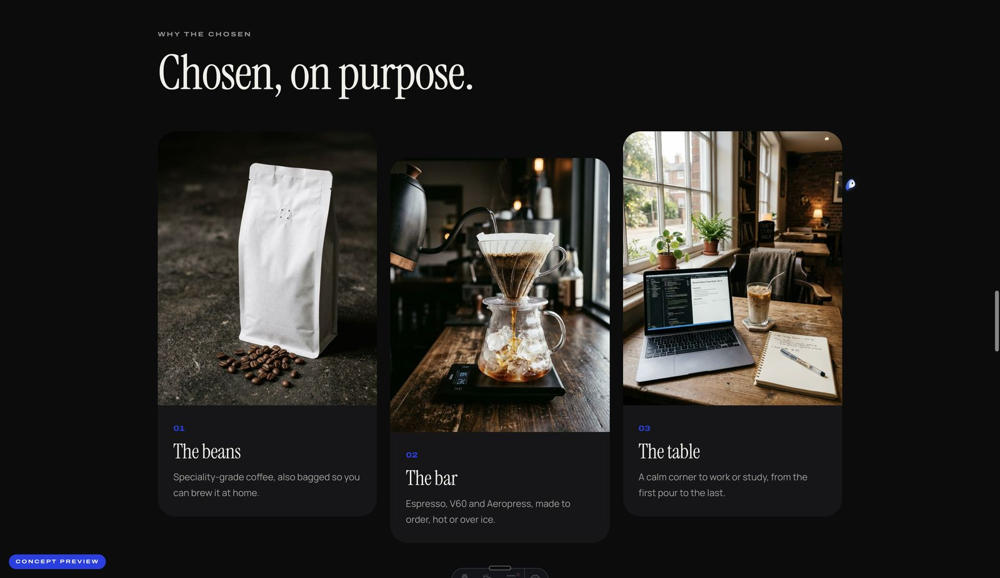
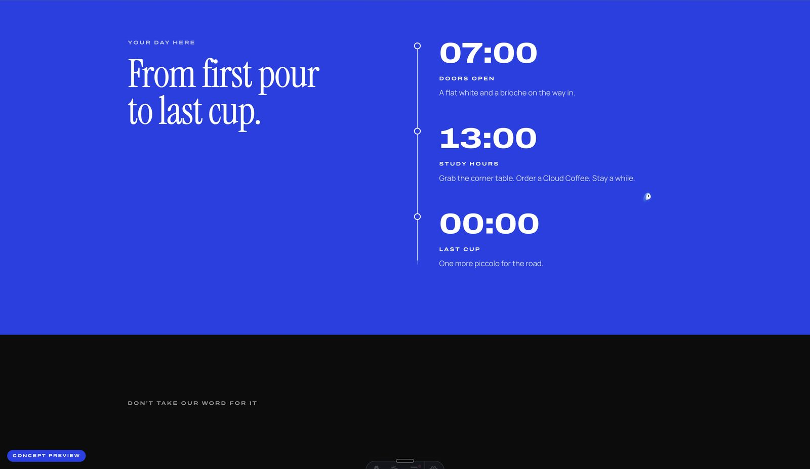
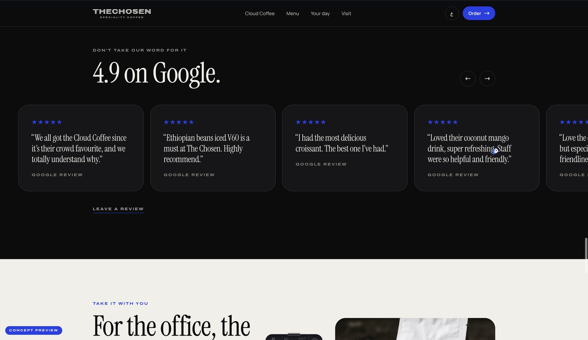
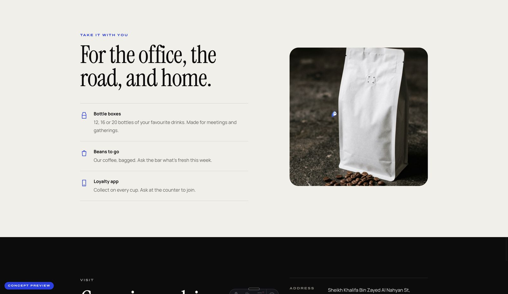
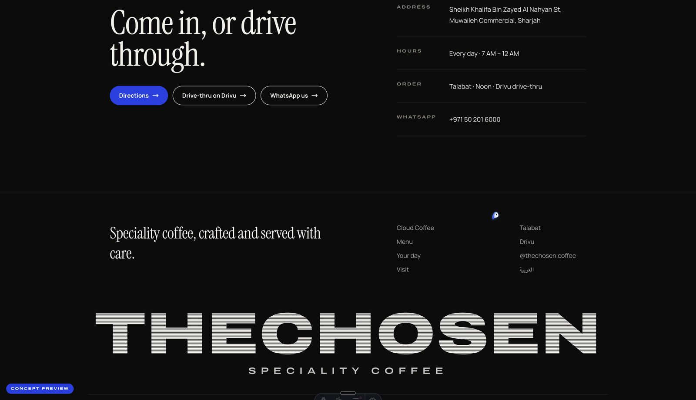

# The Chosen Speciality Coffee: concept website

A bilingual (English / Arabic) concept website proposal for **The Chosen Speciality Coffee**, a speciality café in Muwaileh Commercial, Sharjah. Dark, calm and editorial, with a cobalt-blue accent taken from the café's cups.



| | |
|---|---|
| **Status** | Concept / proposal. Not deployed. Marked `noindex` while `isConcept` is `true` |
| **Languages** | English (`/`) and Arabic (`/ar/`, full right-to-left layout) |
| **Output** | Fully static site (no server, no database) |
| **Stack** | Astro, Tailwind CSS v4, GSAP + ScrollTrigger, Lenis, TypeScript |
| **Pages built** | 2 (`/` and `/ar/`) in about 8 seconds |

## Table of contents

1. [What's on the page](#whats-on-the-page)
2. [Screenshots](#screenshots)
3. [Tech stack](#tech-stack)
4. [Getting started](#getting-started)
5. [Project structure](#project-structure)
6. [Editing the content](#editing-the-content)
7. [Design system](#design-system)
8. [Motion and accessibility](#motion-and-accessibility)
9. [SEO and structured data](#seo-and-structured-data)
10. [Images](#images)
11. [Deploying](#deploying)
12. [Go-live checklist](#go-live-checklist)
13. [Notes and disclaimer](#notes-and-disclaimer)

## What's on the page

One long scrolling page, in this order:

| # | Section | What it does |
|---|---|---|
| 1 | **Header** | Fixed nav (Cloud Coffee, Menu, Your day, Visit) that tucks away as you scroll down and returns as you scroll up, the language switch, and an "Order" button |
| 2 | **Hero** | "Keep moving *forward.*" over an espresso-pour photo, with trust chips (4.9 on Google, open 7 AM to 12 AM, drive-thru on Drivu) and a "Relocated, Reopened, Brewing" badge |
| 3 | **Ticker** | A running strip of favourites: Cloud Coffee, Spanish Latte, Iced V60, The Ohio, Flat White and more |
| 4 | **Cloud Coffee** | The one everyone asks for: coffee whipped with coconut water, served cold. Photo with a slow parallax drift and a pulled customer quote |
| 5 | **The "The" list** | The house signatures that all start with "The": The Ohio, The Iced Ohio, The Tiramisu, The Golden Espresso, The Peach Iced Tea, The Cascara, The Chilli. As you scroll, the row nearest the middle of the screen lights up |
| 6 | **Menu** | Four groups: Espresso bar, Slow bar and matcha, Brioche and bowls, Grilled sandos. About 25 items. Bites are priced in AED as on Talabat; drink prices are marked "at the counter" |
| 7 | **Craft** | "Chosen, on purpose." Three cards: the beans, the bar, the table |
| 8 | **Ritual** | "From first pour to last cup." A timeline on a full cobalt band: 07:00 doors open, 13:00 study hours, 00:00 last cup |
| 9 | **Reviews** | "4.9 on Google." A swipeable review carousel with next / previous arrows |
| 10 | **Take home** | Bottle boxes (12, 16 or 20 bottles), beans to go, and the loyalty app |
| 11 | **Visit** | Address, hours, directions, an order link, a **drive-thru** link and a **WhatsApp** button |
| 12 | **Footer** | Giant wordmark and nav |

Smaller details worth knowing:

- **WhatsApp deep link:** `whatsappLink(lang)` in `src/data/site.ts` builds a `wa.me` link with a pre-filled message, and the message is different in English and Arabic.
- **Ordering:** the "Order" buttons go to Talabat; the drive-thru button goes to the café's Drivu page.
- **Concept tag:** a small "Concept preview" pill is pinned to the corner while `isConcept` is `true`.

## Screenshots

Captured at desktop width, in scroll order.

| Cloud Coffee | The "The" list | Menu |
|---|---|---|
|  |  |  |

| Menu, bites | Craft | Your day |
|---|---|---|
|  |  |  |

| Reviews | Take home | Visit and footer |
|---|---|---|
|  |  |  |

## Tech stack

| Area | Choice |
|---|---|
| Framework | [Astro](https://astro.build) 7 (static output, `trailingSlash: 'always'`) |
| Styling | [Tailwind CSS](https://tailwindcss.com) v4 through the `@tailwindcss/vite` plugin, with design tokens in `@theme` |
| Motion | [GSAP](https://gsap.com) 3 + ScrollTrigger, and [Lenis](https://lenis.darkroom.engineering) for smooth scrolling |
| Fonts | Self-hosted through Fontsource: **Instrument Serif** (headlines), **Manrope** (body), **Archivo Variable** (wide caps labels), **IBM Plex Sans Arabic** (Arabic) |
| Images | Astro's `<Picture>` component: responsive widths, AVIF and WebP |
| Language | TypeScript for data, scripts and the content types |
| Runtime | Node 22 or newer (see `.nvmrc` and `engines` in `package.json`) |

There are no environment variables and no secrets. Nothing runs on a server.

## Getting started

You need **Node.js 22.23.4 or newer** (if you use `nvm`, run `nvm use` and it will pick up `.nvmrc`).

```bash
git clone https://github.com/4pfanas/the-chosen.git
cd the-chosen
npm ci            # or: npm install
npm run dev       # http://localhost:4321  (Arabic: http://localhost:4321/ar/)
```

| Command | What it does |
|---|---|
| `npm run dev` | Starts the dev server with hot reload |
| `npm run build` | Builds the static site into `dist/` |
| `npm run preview` | Serves the built `dist/` locally so you can test the real output |

## Project structure

```text
the-chosen/
├── astro.config.mjs        # site URL, static output, Tailwind plugin
├── package.json
├── public/                 # favicon.svg, robots.txt (copied as-is)
├── docs/screenshots/       # preview images used by this README
└── src/
    ├── pages/
    │   ├── index.astro     # English page  (/)
    │   └── ar/index.astro  # Arabic page   (/ar/)
    ├── layouts/Layout.astro        # <head>, SEO, JSON-LD, hreflang, dir="rtl"
    ├── components/
    │   ├── Home.astro              # assembles the sections in order
    │   ├── Header · Hero · Cloud · Signatures · Menu · Craft
    │   ├── Ritual · Reviews · TakeHome · Visit · Footer · Wordmark
    │   └── ui/                     # Button.astro, SmartImage.astro
    ├── data/
    │   ├── site.ts                 # business facts: links, hours, geo, WhatsApp
    │   └── content.ts              # ALL copy and menu items, English + Arabic
    ├── lib/images.ts               # looks images up by file name
    ├── scripts/site.ts             # header, language switch, review arrows, Lenis, GSAP
    ├── styles/global.css           # Tailwind import + brand tokens + type styles
    └── assets/images/              # hero, product and venue photos
```

## Editing the content

Almost everything you would want to change lives in two files, and nothing needs to touch the components.

| To change | Edit |
|---|---|
| WhatsApp number and message, Talabat link, drive-thru link, Instagram, map link, address, coordinates, opening hours, rating, theme colour | `src/data/site.ts` |
| Headlines, taglines, trust chips, signature list, craft cards, timeline, reviews, take-home items (English **and** Arabic) | `src/data/content.ts` |
| Menu groups and items | `content[lang].menu.groups` in `src/data/content.ts` |
| The "The" list | `content[lang].signatures.items` |
| Brand colours and fonts | the `@theme` block at the top of `src/styles/global.css` |

Rules of thumb:

- Every piece of copy exists twice, under `content.en` and `content.ar`. The Arabic object is typed against the English one (`const ar: Content`), so if you add a field to one and forget the other, TypeScript flags it.
- A menu item may have a `price` (AED, as a string) or just a `note`. Drinks are listed without prices on purpose; the menu note says to ask at the counter.
- Photos are referenced by file name, for example `image: 'beans-bag'` in the craft cards.

## Design system

Black and white with the cobalt of The Chosen's cups.

| Token | Value | Used for |
|---|---|---|
| `ink` | `#0C0C0D` | Main dark background |
| `coal` | `#161618` | Cards on dark |
| `ash` | `#232326` | Raised dark surfaces |
| `paper` | `#F2EFE9` | Light sections, text on dark |
| `bone` | `#E6E1D8` | Light surfaces and image frames |
| `stone` | `#8C877E` | Muted text |
| `cobalt` | `#2440E6` | The accent: buttons, tags, the timeline band |
| `cobalt-deep` | `#1A2FAE` | Pressed and hover states |

Type: big poetic headlines in **Instrument Serif** (tight tracking, 0.95 line height), body in **Manrope**, small wide caps labels in **Archivo**, and **IBM Plex Sans Arabic** for the Arabic page. Sizes use fluid `clamp()`. One easing curve (`--ease-calm`) gives the whole site a slow, unhurried feel.

## Motion and accessibility

- **Calm motion:** Lenis smooth scrolling with a slow response, a hero reveal, scroll reveals, a drifting photo in the Cloud Coffee section, the lit-row effect on the "The" list, and the timeline in the ritual section.
- **Reduced motion is respected.** If the visitor asks their system for reduced motion, Lenis and the GSAP animations do not run. The header, language switch and review arrows always work.
- **Review carousel:** uses native scroll-snap, and the arrows just nudge it by one card, so it also works with touch and trackpads.
- **Other basics:** a "Skip to content" link, visible `:focus-visible` outlines in cobalt, `lang` and `dir` set per page, and the phone number kept left-to-right inside the Arabic page.

## SEO and structured data

`src/layouts/Layout.astro` emits, per language:

- `<title>` and meta description, a canonical URL, and `hreflang` links for `en`, `ar` and `x-default`
- Open Graph tags (and an `og:image` if a file named `og` exists in `src/assets/images/`)
- A `theme-color` meta tag
- A `CafeOrCoffeeShop` JSON-LD block with address, geo coordinates, opening hours and a link to the menu
- `robots: noindex, nofollow` **only while `isConcept` is `true`**

## Images

Photos live in `src/assets/images/` and are referenced by **file name without extension** through `src/lib/images.ts`, which scans the folder at build time. `SmartImage.astro` turns each into a responsive `<picture>` (AVIF and WebP in several widths). If a referenced file is missing, a branded placeholder renders instead, so the build never fails while photography is pending.

Current files: `hero-pour`, `cloud-coffee`, `the-ohio`, `iced-v60`, `beans-bag`, `the-table`, `brioche-labneh`. To swap one, drop a new file with the same name in the folder and rebuild.

## Deploying

The site is static, so any static host works. `astro.config.mjs` is set up for **Cloudflare Pages**:

| Setting | Value |
|---|---|
| Build command | `npm run build` |
| Output directory | `dist` |
| Node version | 22 or newer |

On Vercel or Netlify, pick the Astro preset (or the same build command and output directory above). Set the real domain in `astro.config.mjs` (`site: '...'`) so canonical, hreflang and Open Graph URLs are correct. It currently points at the placeholder `https://the-chosen-coffee.pages.dev`.

## Go-live checklist

- [ ] Set `site` in `astro.config.mjs` to the real domain
- [ ] Set `isConcept: false` in `src/data/site.ts`. This removes `noindex`, the "Concept preview" pill and the footer note
- [ ] Re-check the WhatsApp number, Talabat and Drivu links, hours and rating against the live listings
- [ ] Confirm the menu and prices with the café; add drink prices if they want them shown
- [ ] Replace placeholder photos with approved, rights-cleared photography, and add an `og.jpg` for link previews
- [ ] Review the Arabic copy with a native speaker
- [ ] Decide the crawling policy: `public/robots.txt` currently allows everything, so rely on `isConcept` to keep a preview out of search until launch
- [ ] Run `npm run build && npm run preview` and click through both `/` and `/ar/`

## Notes and disclaimer

This is concept and proposal work. Business details (address, hours, links, rating, review excerpts and menu prices) reflect public listings such as Google, Talabat and Drivu at the time of writing and belong to their respective owners. They can change, so verify them before publishing. Confirm usage rights for any photography before the site goes public.
